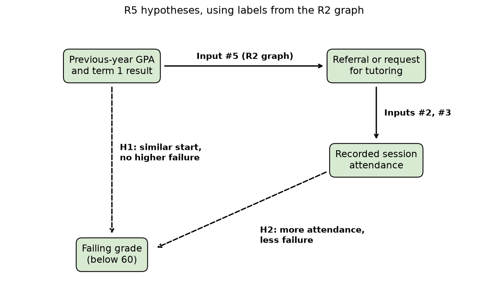

# R5 Hypotheses 

## Specific Problem
Among students with similar starting points, do referred students still fail
more often than non-referred students (H1)? Among referred students, is
attending more sessions linked to failing less often (H2)?

## Hypothesis 1: Referral Selection

If referred students fail more because they were already struggling, then the gap should go away when we compare students with similar prior grades and term 1 results. A student counts as referred in a subject only if the referral was made before term 3 started on February 18, 2026, so the referral comes before the term 3 outcome. Student-subject pairs first referred during term 3 (1,379) are left out because counting them as non-referred would put referred students in the
comparison group.

**What we expect to see**

Among students in the same prior GPA group and with the same term 1 results, the referred students will not have a higher term 3 failure rate than non-referred students. The hypothesis is wrong if the referred students fail more often than the non-referred students in most groups. 

**Planned test:** Group students by prior GPA and term 1 result, with students who have no prior GPA as their own group. Compare the term 3 failure rates of referred and non-referred students in each group.

## Hypothesis 2: Attendance 

If attending tutoring helps students pass, then referred students who 
attended more should fail less. 

**What we expect to see**

Among referred students in the same prior GPA group, those who attended 
more sessions before term 3 will have a lower term 3 failure rate than those who attended fewer tutoring sessions. The hypothesis is wrong if the rate does not go down in most groups. 

**Planned test:** Calculate attendance using sessions before term 3, leaving out students with none scheduled. Compare term 3 failure rates across attendance groups (0-25%, above 25-50%, above 50-75%, above 75-100%) within each prior GPA group, with students who have no prior
GPA as their own group.

## How we will decide
We report the counts for every group. Groups with fewer than 50 student-subject pairs are left out when deciding the result because rates from very small groups are unreliable. "Most groups" means more than half of the remaining groups. 

## Hypotheses on the graph
Solid arrows and labels come from the R2 graph. The H1 arrow is new and is not an input. The H2 arrow is the R2 claim under test, with the direction we predict.

## Changes since M1
All of these changes were made before any model results were seen.

The H1 "What we expect to see" section had the same text as H2 by mistake, so it described attendance instead of H1. It now says that referred students will not have a higher term 3 failure rate than non-referred students in the same GPA group and term 1 result.

H1 also did not say when a student counts as referred. We added that the referral must be made before February 18, 2026, so the cause comes before the term 3 outcome.

The "How we will decide" section had a broken sentence and no rule for small groups. It now says that groups with fewer than 50 student-subject pairs are left out when deciding the result.

The H2 attendance groups were written as 0-25%, 25-50%, 50-75% and 75-100%, which put 25%, 50% and 75% in two groups each. They are now 0-25%, above 25-50%, above 50-75% and above 75-100%.

The Specific Problem now covers both H1 and H2. H1 now says that students first
referred during term 3 are left out. H1 and H2 now treat students with no prior GPA as their own group.

We also fixed several typos and headings that did not display correctly.